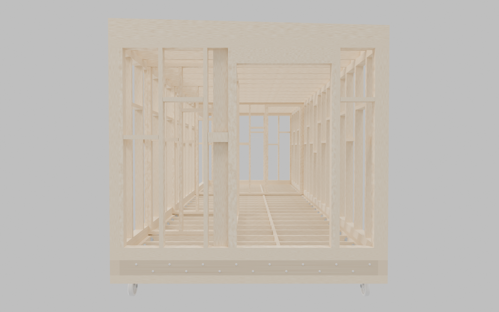
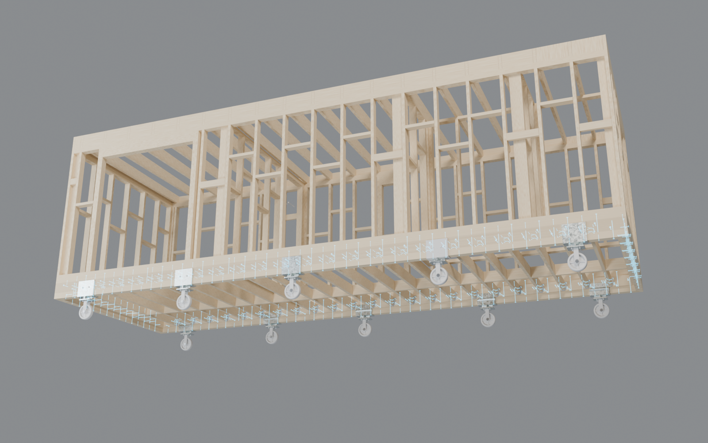
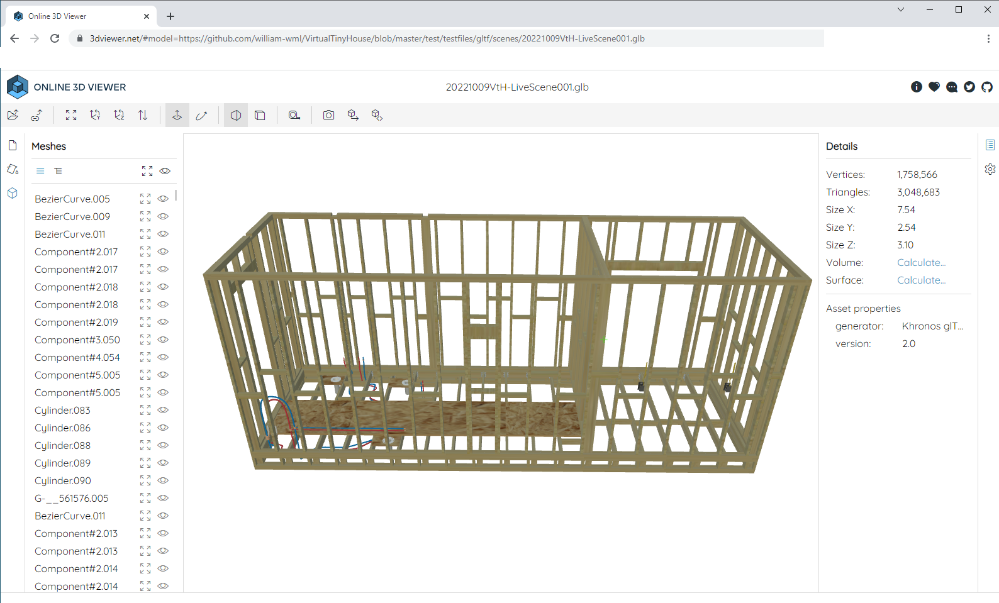

# VirtualTinyHouse

VirtualTinyHouse (VtH) seeks to design and share a virtual tiny house on wheels with Blender (a free and open-source 3D computer graphics software). The intent is to support characteristics of kinesthetic learning largely within one file for users interested in 3D-modeling, architecture, and/or building real assets.

# Overview

VtH's repository is currently structured to share illustrations and compressed drafts of designs compiled to date.

Perspectives of VtH's updates can be readily viewed from the [wiki page](https://github.com/william-wml/VirtualTinyHouse/wiki), including a majority of illustrations.

## Render A

## Render B

## Interactive 3D Model

Contents and functionality continue to progress. A handful of updates can be discerned from a Screenshot & a link to a interactive 3D Scene - presented below.

### Screenshot

[Link to a Live 3D Scene](https://william-wml.github.io/VirtualTinyHouse/)
